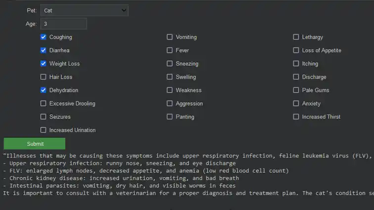
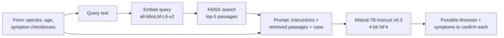

<p align="center">
  
</p>

# VetDSS: Veterinary Decision Support with a Local LLM

VetDSS suggests possible illnesses for a cat or dog from a checklist of symptoms. It also lists the **additional symptoms a veterinarian should check** to confirm or rule out each one. It runs **Mistral-7B-Instruct v0.3** loaded in 4-bit, grounded with **retrieval-augmented generation (RAG)** over a small veterinary knowledge base.

[Open in Colab](https://colab.research.google.com/drive/1Iyac5p0w0t_sLPmJwqWQJzaNmpOLQ9Bi?usp=sharing) · [Project page](https://newtonhaven.github.io/vet-dss-llm/)

> [!WARNING]
> **Research and learning project, not a medical device.** Outputs can be wrong or incomplete and must not replace an examination by a licensed veterinarian.


## Why

Veterinarians work under time pressure, and symptoms in animals often overlap between conditions. The goal is an assistant that:

- correlates reported symptoms with possible illnesses,
- points out symptoms that may have been overlooked, and
- suggests what to check next, instead of giving one confident diagnosis.

## How it works



1. **Structured input.** Instead of free text, the user picks the species (dog or cat), enters an age, and ticks symptoms from a fixed list of 26. Limiting input to known terms keeps queries close to the vocabulary of the knowledge base and reduces off-topic prompts.
2. **Retrieval.** Every passage in the knowledge base is embedded once with `sentence-transformers/all-MiniLM-L6-v2` and stored in a FAISS `IndexFlatL2` index. At query time, the five closest passages are retrieved.
3. **Generation.** The retrieved passages, the case details and a fixed instruction set are sent to Mistral-7B-Instruct v0.3 through its chat template.
4. **Output.** The model lists candidate illnesses, the extra symptoms that would confirm each, and a recommendation to consult a veterinarian.

### Instruction set

The model is told to:

- act as a veterinary assistant for cats and dogs,
- be clear, concise and actionable,
- when several illnesses fit, list them with the additional symptoms needed to confirm each,
- avoid speculation and alarming language,
- put the animal's wellbeing first, and
- say so rather than invent an answer when it does not know.

### Model and inference

| Setting | Value |
| --- | --- |
| Model | `mistralai/Mistral-7B-Instruct-v0.3` (Apache 2.0) |
| Loading | 4-bit NF4 quantization with `bitsandbytes`, fp16 compute |
| Decoding | sampling, temperature 0.7, up to 250 new tokens |
| Retrieval | `all-MiniLM-L6-v2` embeddings, FAISS exact L2 search, k = 5 |
| Interface | `ipywidgets` form inside Colab |

<!-- Add measured numbers here after running both loads:
| Precision | GPU memory (model.get_memory_footprint()) |
| fp16      | __ GB |
| 4-bit NF4 | __ GB |
-->

Mistral 7B was chosen for its permissive Apache 2.0 licence and because, at release, it outperformed Llama 2 13B on most reported benchmarks despite being about half the size.

## Knowledge base

All files are in [`Data/`](Data) and are loaded straight from this repository by the notebook.

| File | Content |
| --- | --- |
| `DogDiseases_RAG.json` | Common dog diseases: descriptions, symptoms, treatments |
| `CatDiseases_RAG.json` | Common cat diseases: descriptions, symptoms, treatments |
| `dog_disease_data.json` | Additional dog disease records |
| `dogThreatmentData.csv` | Dog cases: symptoms, diagnosis, treatment plan, follow-up result |

The source material came from the [VetPetCare dataset](https://huggingface.co/datasets/infinite-dataset-hub/VetPetCare), the [Animal Disease dataset](https://www.kaggle.com/datasets/gracehephzibahm/animal-disease) and [ASPCA](https://www.aspca.org/) articles. It was cleaned before use: formats were normalized, special characters fixed and unclear entries corrected. Early versions also used PDFs, but text extracted from them was poorly formatted, so the knowledge base is now stored as structured JSON and CSV.

## Early experiments

These were **qualitative checks on single cases**, not a benchmark.

- **Without reference material:** given ten of the fourteen typical symptoms of a feline upper respiratory infection (URI), the model listed several candidates, with URI second.
- **With reference material:** for the same case, it named URI as the most likely cause and listed rhinitis and feline herpesvirus as alternatives.
- **Hallucination stress test:** for a long, mixed list of symptoms, the first prompt version was slow, mixed up conditions, and tried to force a match for every symptom. Cleaning the data, adding the retrieved context and tightening the instructions produced answers that kept conditions separate and listed the missing symptoms for each.

## Run it

**Easiest:** open the [Colab notebook](https://colab.research.google.com/drive/1Iyac5p0w0t_sLPmJwqWQJzaNmpOLQ9Bi?usp=sharing) and select a **GPU runtime**.

1. Create a Hugging Face access token and accept the model's terms on the [Mistral-7B-Instruct-v0.3 page](https://huggingface.co/mistralai/Mistral-7B-Instruct-v0.3) if prompted.
2. Add the token as a Colab secret named `hfToken`, or paste it into the first cell.
3. Run the cells in order: install, load model, load data, build index, launch form.
4. Pick a species, enter the age, tick the symptoms and press **Submit**.

## Repository contents

```text
vetDSS.ipynb        # Full pipeline: setup, model, retrieval index, form UI
Data/               # Knowledge base (JSON + CSV)
index.html, datasets.html, static/   # Project page (GitHub Pages)
```

## Limitations

- **No quantitative evaluation yet.** Results above come from a handful of hand-checked cases.
- **Small, uneven knowledge base.** There is more dog material than cat material, and coverage of rare conditions is thin.
- **Fixed symptom list.** Only 26 symptoms can be selected, so conditions with other signs cannot be described.
- **Generic embeddings.** `all-MiniLM-L6-v2` is not trained on veterinary text, so related terms can be missed.
- **Sampling output.** With temperature 0.7, the same input can give different answers.

## License

Code is released under the [MIT License](LICENSE). Dataset content remains under the terms of its original sources.
